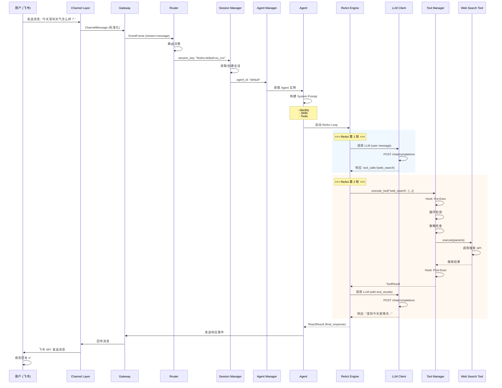

# 🌤️ HunterClaw 完整流程详解: "查询今天天气"

本文档通过一个简单的"查询今天天气"示例，完整展示 HunterClaw 内部的执行流程，包括每一层的调用细节。

---

## 📋 目录

1. [场景设置](#场景设置)
2. [完整调用链](#完整调用链)
3. [详细执行流程](#详细执行流程)
4. [核心组件说明](#核心组件说明)
5. [时序图](#时序图)
6. [关键代码路径](#关键代码路径)

---

## 🎬 场景设置

### 用户输入
```
用户 (飞书): 今天深圳天气怎么样？
```

### 系统配置
- **Channel**: Feishu (飞书)
- **Account ID**: default
- **Agent**: default (使用 Claude-3.5-Sonnet)
- **Workspace**: `/home/user/project`
- **可用工具**: 
  - `web_search` (网络搜索)
  - `exec` (执行命令)
  - `read_file` (读取文件)
  - 等...

---

## 🔗 完整调用链

### 宏观视角 (10000英尺)

```
用户消息 
  ↓
[1] Channel Layer (飞书接收)
  ↓
[2] Gateway/Protocol Layer (消息标准化)
  ↓
[3] Routing Layer (会话路由)
  ↓
[4] Session Manager (会话管理)
  ↓
[5] Agent Manager (Agent 选择)
  ↓
[6] Agent Execution (核心执行)
  ↓
[7] ReAct Loop (推理-行动循环)
  ↓
[8] LLM Invocation (调用大模型)
  ↓
[9] Tool Execution (执行工具)
  ↓
[10] Result Processing (结果处理)
  ↓
[11] Response Delivery (响应回传)
  ↓
用户收到回复
```

---

## 📖 详细执行流程

### 1️⃣ Channel Layer - 飞书消息接收

**文件**: `src/channels/feishu_channel.cc`

#### 流程

```cpp
// 飞书 Webhook 收到消息
POST https://hunterclaw.example.com/channels/feishu/webhook
{
  "event": {
    "message": {
      "message_id": "om_xxx",
      "chat_id": "oc_xxx",
      "sender": {
        "sender_id": {
          "open_id": "ou_xxx"
        }
      },
      "content": "{\"text\":\"今天深圳天气怎么样？\"}"
    }
  }
}
```

#### 代码路径

```cpp
// FeishuAdapter::handle_webhook()
void FeishuAdapter::handle_webhook(const nlohmann::json& payload) {
    // 1. 验证签名和时间戳
    if (!verify_signature(payload)) {
        return;
    }
    
    // 2. 提取消息内容
    auto event = payload["event"];
    std::string chat_id = event["message"]["chat_id"];
    std::string sender_id = event["message"]["sender"]["sender_id"]["open_id"];
    std::string message_text = extract_text(event["message"]["content"]);
    
    // 3. 构建标准化消息
    ChannelMessage msg;
    msg.id = generate_message_id();
    msg.channel_id = "feishu";
    msg.account_id = account_id_;
    msg.from = sender_id;
    msg.to = chat_id;
    msg.type = MessageType::Text;
    msg.text = message_text;  // "今天深圳天气怎么样？"
    msg.timestamp = std::chrono::system_clock::now();
    
    // 4. 触发回调 (发送到 Gateway)
    if (context_.on_message_received) {
        context_.on_message_received(msg);
    }
}
```

**输出**: 标准化的 `ChannelMessage` 对象

---

### 2️⃣ Gateway/Protocol Layer - 消息标准化

**文件**: `src/gateway/gateway.cc`

#### 流程

Channel Adapter 将消息发送到 Gateway Client，Gateway 将其转换为统一的事件格式。

```cpp
// GatewayClient 收到消息事件
void GatewayClient::emit_message_event(const ChannelMessage& msg) {
    // 构建 EventFrame
    EventFrame event;
    event.stream = "message";
    event.seq = next_seq_++;
    event.timestamp_ms = now_ms();
    event.data = {
        {"channel", msg.channel_id},
        {"account_id", msg.account_id},
        {"from", msg.from},
        {"to", msg.to},
        {"text", msg.text},
        {"message_id", msg.id}
    };
    
    // 触发事件回调
    if (options_.on_event) {
        options_.on_event(event);
    }
}
```

**输出**: 标准化的 `EventFrame` (stream="message")

---

### 3️⃣ Routing Layer - 会话路由

**文件**: `src/routing/router.cc`

#### 流程

Router 根据消息来源 (channel, account, peer) 确定使用哪个 Agent 和 Session。

```cpp
// MessageRouter::route()
RouteResult DefaultMessageRouter::route(const RouteInput& input) {
    // input:
    //   - channel: "feishu"
    //   - account_id: "default"
    //   - peer: {kind: "user", id: "ou_xxx"}
    //   - chat_type: Direct
    
    // 1. 查找匹配的 Binding
    auto binding = find_matching_binding(input);
    
    // 2. 如果没有匹配，使用默认 Agent
    std::string agent_id = binding 
        ? binding->agent_id 
        : default_agent_id_;  // "default"
    
    // 3. 生成 Session Key (基于 dm_scope)
    // dm_scope = PerChannelPeer (默认安全模式)
    std::string session_key = build_session_key(
        "feishu",     // channel
        "default",    // account_id
        "ou_xxx"      // peer_id
    );
    // session_key = "feishu:default:ou_xxx"
    
    RouteResult result;
    result.agent_id = agent_id;
    result.session_key = session_key;
    result.should_respond = true;
    
    return result;
}
```

**输出**: 
- `agent_id`: "default"
- `session_key`: "feishu:default:ou_xxx"

---

### 4️⃣ Session Manager - 会话管理

**文件**: `src/sessions/session_manager.cc`

#### 流程

Session Manager 根据 `session_key` 获取或创建会话。

```cpp
// SessionManager::get_or_create_session()
core::Result<SessionEntry> FileSessionManager::get_or_create_session(
    const std::string& session_key,
    const std::string& agent_id,
    const SessionMetadata& metadata
) {
    // session_key = "feishu:default:ou_xxx"
    
    // 1. 检查会话文件是否存在
    std::string file_path = get_session_file_path(session_key);
    // file_path = "~/.hunterclaw/sessions/feishu_default_ou_xxx.json"
    
    SessionEntry session;
    
    if (fs::exists(file_path)) {
        // 2. 读取现有会话
        auto result = read_session(file_path);
        if (result.is_ok()) {
            session = result.value;
            
            // 3. 检查是否需要重置 (daily reset / idle timeout)
            if (should_reset(session)) {
                // 重置会话历史
                session.messages.clear();
                session.input_tokens = 0;
                session.output_tokens = 0;
            }
        }
    } else {
        // 4. 创建新会话
        session.session_id = generate_uuid();
        session.session_key = session_key;
        session.agent_id = agent_id;
        session.created_at = now_ms();
        session.metadata = metadata;
    }
    
    session.updated_at = now_ms();
    
    // 5. 保存会话
    write_session(session);
    
    return core::Result<SessionEntry>::ok(session);
}
```

**输出**: `SessionEntry` (包含历史消息)

---

### 5️⃣ Agent Manager - Agent 选择

**文件**: `src/agents/agent.cc`

#### 流程

Agent Manager 根据 `agent_id` 获取 Agent 实例。

```cpp
// AgentManager::get_agent()
Agent::Ptr AgentManager::get_agent(const std::string& agent_id) const {
    std::lock_guard<std::mutex> lock(mutex_);
    
    // agent_id = "default"
    
    auto it = agents_.find(agent_id);
    if (it != agents_.end()) {
        return it->second;  // 返回 DefaultAgent 实例
    }
    
    // 如果没有找到，返回默认 Agent
    return agents_.at(default_agent_id_);
}
```

**输出**: `Agent::Ptr` (DefaultAgent 实例)

---

### 6️⃣ Agent Execution - 核心执行

**文件**: `src/agents/agent.cc`

#### 流程

Agent 接收消息并启动执行流程。

```cpp
// DefaultAgent::run()
core::Result<std::string> DefaultAgent::run(
    const std::string& message,
    const std::map<std::string, std::string>& options
) {
    // message = "今天深圳天气怎么样？"
    
    // 1. 生成 Run ID
    std::string run_id = generate_run_id();  // "run_abc123"
    
    // 2. 创建 Run Context
    auto context = std::make_shared<AgentRunContext>();
    context->run_id = run_id;
    context->session_key = options.at("session_key");
    context->agent_id = config_.id;
    context->started_at = now_ms();
    context->status = "running";
    context->skill_manager = skill_manager_;
    context->channel_manager = channel_manager_;
    
    {
        std::lock_guard<std::mutex> lock(mutex_);
        active_runs_[run_id] = context;
    }
    
    // 3. 触发 Lifecycle Event (Start)
    emit_lifecycle_event(run_id, AgentLifecyclePhase::Start);
    
    // 4. 构建 System Prompt
    auto system_prompt_result = build_system_prompt();
    if (system_prompt_result.is_err()) {
        return core::Result<std::string>::err(system_prompt_result.error);
    }
    std::string system_prompt = system_prompt_result.value;
    
    // 5. 调用 ReAct 执行引擎
    auto react_result = call_react_engine(
        system_prompt,
        message,
        context
    );
    
    // 6. 处理结果
    if (react_result.is_ok()) {
        emit_lifecycle_event(run_id, AgentLifecyclePhase::End, {
            {"stop_reason", "complete"}
        });
    } else {
        emit_lifecycle_event(run_id, AgentLifecyclePhase::End, {
            {"stop_reason", "error"},
            {"error", react_result.error}
        });
    }
    
    // 7. 清理 Run Context
    {
        std::lock_guard<std::mutex> lock(mutex_);
        active_runs_.erase(run_id);
    }
    
    return core::Result<std::string>::ok(run_id);
}
```

#### System Prompt 构建

```cpp
// DefaultAgent::build_system_prompt()
core::Result<std::string> DefaultAgent::build_system_prompt() const {
    std::ostringstream ss;
    
    // 1. Identity
    if (!config_.identity.name.empty()) {
        ss << "You are " << config_.identity.name << ".\n";
        ss << config_.identity.persona << "\n\n";
    }
    
    // 2. Skills (100% 对齐 OpenClaw)
    if (skill_manager_) {
        skills::SkillEligibilityContext ctx;
        ctx.current_os = get_current_os();
        ctx.has_bin = [](const std::string& bin) { 
            return check_bin_exists(bin); 
        };
        ctx.is_config_path_truthy = [](const std::string& path) {
            return check_config_truthy(path);
        };
        
        // 构建 Skills Prompt
        std::string skills_prompt = skill_manager_->build_skills_prompt(
            ctx, 
            config_.skills  // skill filter
        );
        
        ss << skills_prompt << "\n";
    }
    
    // 3. Tools (内置 + MCP)
    ss << "\n<tools>\n";
    ss << "You have access to the following tools:\n\n";
    // ... Tool definitions ...
    ss << "</tools>\n\n";
    
    // 4. Additional Rules
    for (const auto& rule : config_.identity.rules) {
        ss << "- " << rule << "\n";
    }
    
    return core::Result<std::string>::ok(ss.str());
}
```

**System Prompt 示例** (简化):

```
You are a helpful AI assistant.

<skills>
## 🌐 web-search

Search the web for real-time information.

**Usage**: Use this skill when you need current information...

---
</skills>

<tools>
You have access to the following tools:

1. web_search(query: string) - Search the web
2. exec(command: string) - Execute shell command
3. read_file(path: string) - Read file content
...
</tools>

- Be helpful and accurate
- Always verify information
```

**输出**: `run_id` 和异步执行的结果

---

### 7️⃣ ReAct Loop - 推理-行动循环

**文件**: `src/react/react_engine.cc`

#### 流程

ReAct 引擎实现 **Observe → Reason → Act → Respond** 循环。

```cpp
// ReactEngine::execute_loop()
ReactResult ReactEngine::execute_loop(
    const std::string& user_input,
    const std::vector<llm::Message>& history,
    const StreamCallbacks& callbacks
) {
    ReactResult result;
    std::vector<llm::Message> messages;
    
    // 1. 添加历史消息
    messages.insert(messages.end(), history.begin(), history.end());
    
    // 2. 添加用户消息
    messages.push_back({
        .role = "user",
        .content = user_input  // "今天深圳天气怎么样？"
    });
    
    // 3. ReAct 循环
    int step_count = 0;
    bool should_continue = true;
    
    while (should_continue && step_count < config_.max_steps) {
        step_count++;
        
        // === Step 1: Reason (调用 LLM) ===
        auto llm_response = call_llm(messages, callbacks);
        
        // 提取推理内容 (thinking tags)
        auto reasoning_extraction = extract_reasoning(llm_response.text);
        
        ReactStep step;
        step.type = StepType::Reason;
        step.reasoning = reasoning_extraction.reasoning;
        step.has_reasoning = reasoning_extraction.has_reasoning;
        step.timestamp_ms = now_ms();
        
        // === Step 2: Act (执行工具) ===
        if (!llm_response.tool_calls.empty()) {
            step.type = StepType::Act;
            
            // 执行所有工具调用
            auto tool_results = execute_tools(
                llm_response.tool_calls, 
                callbacks
            );
            
            step.tool_results = tool_results;
            
            // 将工具结果添加到消息历史
            messages.push_back({
                .role = "assistant",
                .content = llm_response.text,
                .tool_calls = llm_response.tool_calls
            });
            
            messages.push_back({
                .role = "tool_results",
                .content = serialize_tool_results(tool_results)
            });
            
            // 继续循环
            should_continue = true;
            
        } else {
            // === Step 3: Respond (回复用户) ===
            step.type = StepType::Respond;
            step.content = reasoning_extraction.remaining_text;
            step.is_final = true;
            
            result.final_response = step.content;
            should_continue = false;
        }
        
        result.steps.push_back(step);
        
        // 触发步骤回调
        if (callbacks.on_step) {
            callbacks.on_step(step);
        }
    }
    
    result.success = true;
    result.total_steps = step_count;
    
    return result;
}
```

#### 详细步骤展开

##### 第 1 轮: LLM 决定使用工具

**输入消息**:
```json
[
  {
    "role": "user",
    "content": "今天深圳天气怎么样？"
  }
]
```

**LLM 响应**:
```json
{
  "content": "我需要搜索深圳的天气信息。",
  "tool_calls": [
    {
      "id": "call_123",
      "type": "function",
      "function": {
        "name": "web_search",
        "arguments": "{\"query\": \"深圳今天天气\"}"
      }
    }
  ]
}
```

##### 第 2 轮: 执行工具并获取结果

**工具执行**:
```cpp
// execute_tools()
auto tool_results = execute_tools(llm_response.tool_calls, callbacks);

// 调用 web_search 工具
ToolResult result = tool_manager_->execute_tool(
    "web_search",
    {{"query", "深圳今天天气"}}
);

// result.content[0].text = 
// "深圳今天天气: 晴天，温度 25-32°C，湿度 65%，东南风 3-4级"
```

**添加到消息历史**:
```json
[
  {
    "role": "user",
    "content": "今天深圳天气怎么样？"
  },
  {
    "role": "assistant",
    "content": "我需要搜索深圳的天气信息。",
    "tool_calls": [...]
  },
  {
    "role": "tool",
    "tool_call_id": "call_123",
    "content": "深圳今天天气: 晴天，温度 25-32°C，湿度 65%，东南风 3-4级"
  }
]
```

##### 第 3 轮: LLM 基于工具结果回复

**输入消息**: (包含上述完整历史)

**LLM 响应**:
```json
{
  "content": "深圳今天是晴天，温度在 25-32°C 之间，湿度约 65%，有东南风 3-4级。天气不错，适合外出活动！",
  "tool_calls": []  // 无工具调用，准备回复
}
```

**ReAct 循环结束**，返回最终响应。

---

### 8️⃣ LLM Invocation - 调用大模型

**文件**: `src/llm/openai_provider.cc`

#### 流程

```cpp
// OpenAIProvider::complete()
core::Result<llm::CompletionResponse> OpenAIProvider::complete(
    const llm::CompletionRequest& request
) {
    // 1. 构建 OpenAI API 请求
    nlohmann::json payload = {
        {"model", config_.model},
        {"messages", serialize_messages(request.messages)},
        {"max_tokens", config_.max_tokens},
        {"temperature", config_.temperature}
    };
    
    // 2. 添加工具定义 (Function Calling)
    if (!request.tools.empty()) {
        payload["tools"] = serialize_tools(request.tools);
        payload["tool_choice"] = "auto";
    }
    
    // 3. 流式调用
    if (request.stream) {
        payload["stream"] = true;
        payload["stream_options"] = {{"include_usage", true}};
    }
    
    // 4. 发送 HTTP 请求
    auto http_result = http_client_->post(
        config_.endpoint + "/chat/completions",
        payload.dump(),
        {
            {"Authorization", "Bearer " + config_.api_key},
            {"Content-Type", "application/json"}
        }
    );
    
    if (http_result.is_err()) {
        return core::Result<CompletionResponse>::err(http_result.error);
    }
    
    // 5. 解析响应
    auto response_json = nlohmann::json::parse(http_result.value);
    
    CompletionResponse response;
    response.content = response_json["choices"][0]["message"]["content"];
    
    // 6. 解析工具调用
    if (response_json["choices"][0]["message"].contains("tool_calls")) {
        response.tool_calls = parse_tool_calls(
            response_json["choices"][0]["message"]["tool_calls"]
        );
    }
    
    // 7. 使用统计
    if (response_json.contains("usage")) {
        response.usage.input_tokens = response_json["usage"]["prompt_tokens"];
        response.usage.output_tokens = response_json["usage"]["completion_tokens"];
        response.usage.total_tokens = response_json["usage"]["total_tokens"];
    }
    
    return core::Result<CompletionResponse>::ok(response);
}
```

**API 请求示例**:

```json
POST https://api.openai.com/v1/chat/completions

{
  "model": "gpt-4",
  "messages": [
    {
      "role": "system",
      "content": "You are a helpful AI assistant...\n<tools>..."
    },
    {
      "role": "user",
      "content": "今天深圳天气怎么样？"
    }
  ],
  "tools": [
    {
      "type": "function",
      "function": {
        "name": "web_search",
        "description": "Search the web",
        "parameters": {
          "type": "object",
          "properties": {
            "query": {"type": "string"}
          },
          "required": ["query"]
        }
      }
    }
  ],
  "max_tokens": 4096,
  "temperature": 0.7,
  "stream": true
}
```

---

### 9️⃣ Tool Execution - 执行工具

**文件**: `src/tools/tool_manager.cc`

#### 流程

```cpp
// ToolManager::execute_tool()
ToolResult ToolManager::execute_tool(
    const std::string& name,
    const core::JsonValue& params,
    ToolUpdateCallback on_update
) {
    // name = "web_search"
    // params = {"query": "深圳今天天气"}
    
    // 1. 获取工具实例
    auto tool = get_tool(name);
    if (!tool) {
        return tool_result::error("Tool not found: " + name);
    }
    
    // 2. Hook: Pre-Execution
    if (hook_manager_) {
        hook_manager_->trigger_pre_exec(name, params);
    }
    
    // 3. 循环检测 (防止无限循环)
    if (loop_detection_enabled_ && loop_detector_) {
        if (loop_detector_->should_block(name, params)) {
            return tool_result::error("Loop detected: " + name);
        }
        loop_detector_->record_call(name, params);
    }
    
    // 4. 策略检查 (权限、审批)
    if (policy_enabled_ && policy_pipeline_) {
        auto policy_result = policy_pipeline_->check(name, params);
        if (!policy_result.allowed) {
            return tool_result::error("Policy violation: " + policy_result.reason);
        }
    }
    
    // 5. 执行工具
    auto start_time = std::chrono::steady_clock::now();
    
    ToolResult result;
    try {
        result = tool->execute(params);
    } catch (const std::exception& e) {
        result = tool_result::error(std::string("Tool execution failed: ") + e.what());
    }
    
    auto end_time = std::chrono::steady_clock::now();
    auto duration_ms = std::chrono::duration_cast<std::chrono::milliseconds>(
        end_time - start_time
    ).count();
    
    // 6. 结果处理 (规范化、截断)
    if (result_normalization_enabled_ && result_pipeline_) {
        result = result_pipeline_->process(result);
    }
    
    // 7. Hook: Post-Execution
    if (hook_manager_) {
        hook_manager_->trigger_post_exec(name, params, result, duration_ms);
    }
    
    return result;
}
```

#### Web Search 工具实现

```cpp
// WebSearchTool::execute()
ToolResult WebSearchTool::execute(const core::JsonValue& params) {
    ToolParams p(params);
    std::string query = p.read_string("query", true);
    
    // 调用搜索 API (例如 Google Search API)
    auto search_result = search_api_->search(query);
    
    if (search_result.is_err()) {
        return tool_result::error(search_result.error);
    }
    
    // 格式化搜索结果
    std::ostringstream ss;
    ss << "搜索结果:\n\n";
    
    for (const auto& item : search_result.value.items) {
        ss << "- " << item.title << "\n";
        ss << "  " << item.snippet << "\n";
        ss << "  URL: " << item.url << "\n\n";
    }
    
    return tool_result::text(ss.str());
}
```

**工具执行结果**:
```
深圳今天天气: 晴天，温度 25-32°C，湿度 65%，东南风 3-4级
```

---

### 🔟 Result Processing - 结果处理

**文件**: `src/react/react_engine.cc`

#### 流程

ReAct 引擎收到 LLM 最终回复后，进行结果处理。

```cpp
// ReactEngine::execute_loop() - 最终步骤
ReactStep final_step;
final_step.type = StepType::Respond;
final_step.content = "深圳今天是晴天，温度在 25-32°C 之间...";
final_step.is_final = true;

result.final_response = final_step.content;
result.success = true;
result.total_steps = 3;
result.tool_calls = 1;

// 触发回调
if (callbacks.on_end) {
    callbacks.on_end();
}

return result;
```

---

### 1️⃣1️⃣ Response Delivery - 响应回传

**文件**: `src/channels/feishu_channel.cc`

#### 流程

Agent 执行完成后，将响应发送回用户。

```cpp
// FeishuAdapter::send_text()
core::Result<bool> FeishuAdapter::send_text(
    const std::string& to,
    const std::string& text
) {
    // to = "oc_xxx" (chat_id)
    // text = "深圳今天是晴天，温度在 25-32°C 之间..."
    
    // 1. 构建飞书消息 API 请求
    nlohmann::json payload = {
        {"msg_type", "text"},
        {"content", {
            {"text", text}
        }}
    };
    
    // 2. 发送 HTTP 请求到飞书 API
    std::string url = "https://open.feishu.cn/open-apis/im/v1/messages";
    url += "?receive_id_type=chat_id";
    
    auto http_result = http_client_->post(
        url,
        payload.dump(),
        {
            {"Authorization", "Bearer " + access_token_},
            {"Content-Type", "application/json"}
        }
    );
    
    if (http_result.is_err()) {
        return core::Result<bool>::err(http_result.error);
    }
    
    // 3. 解析响应
    auto response_json = nlohmann::json::parse(http_result.value);
    
    if (response_json["code"] != 0) {
        return core::Result<bool>::err(
            "Feishu API error: " + response_json["msg"].get<std::string>()
        );
    }
    
    return core::Result<bool>::ok(true);
}
```

**飞书 API 请求**:

```
POST https://open.feishu.cn/open-apis/im/v1/messages?receive_id_type=chat_id
Authorization: Bearer t-xxx

{
  "msg_type": "text",
  "content": {
    "text": "深圳今天是晴天，温度在 25-32°C 之间，湿度约 65%，有东南风 3-4级。天气不错，适合外出活动！"
  }
}
```

**用户收到回复** ✅

---

## 🧩 核心组件说明

### 1. Channel Layer (通道层)

**职责**: 
- 接收来自不同平台的消息 (飞书、Telegram、Discord 等)
- 标准化消息格式
- 发送响应到对应平台

**关键类**:
- `ChannelAdapter` (接口)
- `FeishuAdapter`, `TelegramAdapter` (实现)
- `ChannelManager` (管理所有 Channel)

---

### 2. Gateway/Protocol Layer (网关层)

**职责**:
- WebSocket 连接管理
- 事件序列化/反序列化
- 心跳和重连机制

**关键类**:
- `GatewayClient`
- `EventFrame`, `ResponseFrame`

**协议对齐**: 100% 对齐 OpenClaw Gateway Protocol

---

### 3. Routing Layer (路由层)

**职责**:
- 根据消息来源路由到对应的 Agent
- 生成 Session Key
- 处理 Binding 规则 (peer, guild, team)

**关键类**:
- `MessageRouter`
- `RouteInput`, `RouteResult`
- `ChannelBinding`

**路由策略**: 7 层优先级匹配 (100% 对齐 OpenClaw)

---

### 4. Session Manager (会话管理层)

**职责**:
- 管理用户会话
- 存储会话历史
- 会话重置策略 (daily reset, idle timeout)

**关键类**:
- `SessionManager`
- `SessionEntry`, `SessionMetadata`

**存储**: 文件系统 (JSON 格式)

---

### 5. Agent Layer (Agent 层)

**职责**:
- Agent 生命周期管理
- System Prompt 构建
- 执行流程编排

**关键类**:
- `Agent` (接口)
- `DefaultAgent` (实现)
- `AgentManager`

**配置**: `AgentConfig` (Model, Skills, Tools, Memory, etc.)

---

### 6. ReAct Engine (推理引擎)

**职责**:
- 实现 Observe → Reason → Act → Respond 循环
- 协调 LLM 和 Tool 执行
- 流式输出处理

**关键类**:
- `ReactEngine`
- `ReactStep`, `ReactResult`

**特性**: 100% 对齐 OpenClaw ReAct 模式

---

### 7. Skill System (技能系统)

**职责**:
- 加载和管理 Skills (SKILL.md)
- 资格检查 (OS, bins, env, config)
- Prompt 构建

**关键类**:
- `SkillManager`
- `SkillEntry`, `SkillEligibilityContext`

**对齐**: 100% 对齐 OpenClaw Skill 系统

---

### 8. Tool System (工具系统)

**职责**:
- 工具注册和管理
- 工具执行 (内置 + MCP)
- Hook 和策略管道

**关键类**:
- `ToolManager`
- `Tool` (接口)
- `ToolHookManager`, `PolicyPipeline`

**对齐**: 100% 对齐 OpenClaw Tool 系统

---

### 9. LLM Client (大模型客户端)

**职责**:
- 调用大模型 API (OpenAI, Anthropic, Google, etc.)
- 流式响应处理
- Token 统计

**关键类**:
- `LLMClient`
- `LLMProvider` (OpenAI, Anthropic, etc.)

**支持**: Function Calling, Streaming, Prompt Caching

---

### 10. Memory System (记忆系统)

**职责**:
- 会话历史管理
- 内存压缩 (Compaction)
- 内存裁剪 (Pruning)

**关键类**:
- `HistoryManager`
- `CompactionEngine`
- `PruningEngine`

**对齐**: 100% 对齐 OpenClaw Memory 系统

---

## 📊 时序图



---

## 🗂️ 关键代码路径

### 文件组织

```
HunterClaw/
├── include/hunterclaw/
│   ├── agents/
│   │   ├── agent.h                    # Agent 接口
│   │   └── react_executor.h           # ReAct 执行器
│   ├── channels/
│   │   └── channel.h                  # Channel 接口
│   ├── gateway/
│   │   ├── client.h                   # Gateway 客户端
│   │   └── protocol.h                 # 协议定义
│   ├── routing/
│   │   └── router.h                   # 路由器
│   ├── sessions/
│   │   └── session_manager.h          # 会话管理
│   ├── skills/
│   │   ├── skill.h                    # Skill 定义
│   │   └── manager.h                  # Skill 管理器
│   ├── tools/
│   │   ├── tool.h                     # Tool 接口
│   │   └── tool_manager.h             # Tool 管理器
│   ├── react/
│   │   └── react_engine.h             # ReAct 引擎
│   ├── llm/
│   │   ├── llm_client.h               # LLM 客户端
│   │   └── provider.h                 # LLM Provider
│   └── memory/
│       ├── compaction.h               # 内存压缩
│       └── pruning.h                  # 内存裁剪
│
└── src/
    ├── channels/
    │   ├── feishu_channel.cc          # 飞书适配器 ⭐
    │   └── telegram_channel.cc        # Telegram 适配器
    ├── gateway/
    │   ├── client.cc                  # Gateway 实现
    │   └── protocol.cc                # 协议序列化
    ├── routing/
    │   └── router.cc                  # 路由实现 ⭐
    ├── sessions/
    │   └── session_manager.cc         # 会话管理实现 ⭐
    ├── agents/
    │   └── agent.cc                   # Agent 实现 ⭐
    ├── skills/
    │   ├── manager.cc                 # Skill Manager ⭐
    │   ├── parser.cc                  # SKILL.md 解析
    │   ├── installer.cc               # Skill 安装器
    │   └── scanner.cc                 # 安全扫描
    ├── tools/
    │   ├── tool_manager.cc            # Tool Manager ⭐
    │   ├── tool_hooks.cc              # Hook 系统
    │   └── builtin_tools.cc           # 内置工具
    ├── react/
    │   ├── react_engine.cc            # ReAct 引擎 ⭐
    │   └── loop_detection.cc          # 循环检测
    ├── llm/
    │   ├── openai_provider.cc         # OpenAI Provider ⭐
    │   └── anthropic_provider.cc      # Anthropic Provider
    └── memory/
        ├── compaction.cc              # 压缩实现
        └── pruning.cc                 # 裁剪实现
```

### 调用链追踪

#### 入口: 飞书消息接收

```
src/channels/feishu_channel.cc:123
  → FeishuAdapter::handle_webhook()
  → context_.on_message_received(msg)
```

#### Gateway 事件分发

```
src/gateway/client.cc:234
  → GatewayClient::emit_message_event()
  → options_.on_event(event)
```

#### 路由决策

```
src/routing/router.cc:72
  → DefaultMessageRouter::route()
  → find_matching_binding()
  → build_session_key()
```

#### 会话管理

```
src/sessions/session_manager.cc:45
  → FileSessionManager::get_or_create_session()
  → read_session() / create_session()
  → should_reset()
```

#### Agent 执行

```
src/agents/agent.cc:156
  → DefaultAgent::run()
  → build_system_prompt()
  → call_react_engine()
```

#### ReAct 循环

```
src/react/react_engine.cc:89
  → ReactEngine::execute_loop()
  → call_llm()
  → execute_tools()
```

#### LLM 调用

```
src/llm/openai_provider.cc:67
  → OpenAIProvider::complete()
  → http_client_->post()
```

#### 工具执行

```
src/tools/tool_manager.cc:123
  → ToolManager::execute_tool()
  → tool->execute(params)
```

#### 响应发送

```
src/channels/feishu_channel.cc:234
  → FeishuAdapter::send_text()
  → http_client_->post()
```

---

## 🎯 关键设计亮点

### 1. 100% OpenClaw 对齐

HunterClaw 在以下方面 **100% 对齐 OpenClaw**:

- ✅ **Gateway Protocol** - WebSocket 协议完全兼容
- ✅ **Routing Mechanism** - 7 层优先级路由
- ✅ **Session Management** - DM Scope + Daily Reset
- ✅ **Skill System** - SKILL.md 格式 + 资格检查
- ✅ **Tool System** - Hook + Policy + MCP
- ✅ **Memory System** - Compaction + Pruning
- ✅ **ReAct Pattern** - Observe-Reason-Act-Respond

### 2. 模块化架构

每一层都是独立的模块，可以单独替换或扩展:

- Channel Layer: 支持任意通信平台
- LLM Client: 支持任意模型提供商
- Tool System: 支持内置 + MCP + 自定义
- Memory System: 支持多种策略

### 3. 流式处理

支持全链路流式处理:

- LLM 流式输出
- Tool 执行进度更新
- 分块回复 (Block Reply)
- 推理流展示 (Thinking Stream)

### 4. 安全保障

多层安全防护:

- Skill 安全扫描 (16 种危险模式)
- Tool 策略管道 (权限、审批)
- 循环检测 (防止无限循环)
- Sandbox 隔离 (Docker/Podman)

### 5. 可观测性

完整的事件和日志:

- Agent Lifecycle Events
- Tool Execution Hooks
- Performance Metrics
- Error Tracking

---

## 📚 相关文档

- **[Skill 系统对齐](SKILL_ALIGNMENT.md)** - Skill 系统详细说明
- **[Tool 系统对齐](TOOL_COMPLETE_ALIGNMENT.md)** - Tool 系统详细说明
- **[ReAct 实现](REACT_SUMMARY.md)** - ReAct 引擎详细说明
- **[Memory 系统](../include/hunterclaw/memory/)** - Memory 管理详细说明
- **[MCP 集成](MCP_INTEGRATION_GUIDE.md)** - MCP 集成指南

---

## 🎓 总结

通过这个简单的"查询今天天气"示例，我们完整展示了 HunterClaw 内部的 **11 层流程**:

1. **Channel Layer** - 接收飞书消息
2. **Gateway Layer** - 标准化事件
3. **Routing Layer** - 会话路由
4. **Session Manager** - 会话管理
5. **Agent Manager** - Agent 选择
6. **Agent Execution** - System Prompt 构建
7. **ReAct Loop** - 推理-行动循环 (3 轮)
8. **LLM Invocation** - 调用大模型 (2 次)
9. **Tool Execution** - 执行 web_search 工具
10. **Result Processing** - 结果处理
11. **Response Delivery** - 响应回传

整个流程展现了 HunterClaw 的核心设计理念:

- 🏗️ **分层架构** - 每一层职责清晰
- 🔌 **可扩展性** - 支持插件和自定义
- 🔄 **可靠性** - 完善的错误处理和重试
- 🚀 **性能** - 流式处理和并发优化
- 🔒 **安全性** - 多层防护和策略控制

**HunterClaw = 生产级 AI Agent 框架** 🦞✨

---

**文档版本**: v1.0  
**最后更新**: 2026-03-09  
**作者**: HunterClaw Team
